# Пульс: запуск и дискавери лента

## Вводные

Пульс – социальная сеть внутри экосистемы Т-Банка. Изначально продукт существовал в Т-Инвестициях как нишевая соцсеть для инвесторов с фокусом на аналитических текстах и профессиональном контенте.

Новая версия Пульса задумывалась как социальная сеть внутри банковского приложения с более широкой тематикой и массовой аудиторией. Пользователи могут делиться личным финансовым опытом, обсуждать повседневные темы и создавать контент самостоятельно.
Для банка продукт стал способом дать пользователям дополнительную ценность – обмен реальным финансовым опытом, верифицированным за счёт связки банковских данных и социальной механики.

## Команда и моя роль

Я отвечал за дизайн-вижен и UX-архитектуру нового социального продукта внутри банковского приложения – от первых концепций до запуска MVP.
В рамках проекта:

- Формировал и защищал дизайн-вижен совместно с бизнесом и дизайн-командой.

- Прорабатывал социальную механику и концепцию дискавери-ленты с пользовательским контентом.

- Создавал hi-fi дизайн ключевых пользовательских сценариев и декомпозировал их на итерации с учётом сжатых сроков.

- Работал с разработкой и бизнесом над поиском решений в условиях технических ограничений.

- После запуска участвовал в развитии продукта: проводил дизайн-ревью, контролировал качество, работал с исследованиями и пользовательским фидбеком, формировал бэклог.
Мы также плотно взаимодействовали с командой Т-Инвестиций, чтобы сохранить ценность Пульса для существующей аудитории.

## Целевая аудитория

Новая версия продукта должна была объединить две аудитории:

- Существующие пользователи Пульса в Т-Инвестициях. Активная и лояльная аудитория, для которой важно было сохранить привычные сценарии, включая создание и чтение длинных аналитических материалов.

- Более широкая аудитория банковского приложения. Пользователи, которые могут делиться личным финансовым опытом, обсуждать повседневные темы и создавать собственный контент.

## Проблемы, которые решали

Нишевый формат Пульса с фокусом на инвестициях и профессиональном контенте достиг потолка по аудитории. Для дальнейшего роста требовалось расширить тематику и позиционирование продукта.

В банковском приложении уже существовали контентные продукты – истории, лента и каналы, которые полностью создавались внутренней редакцией. Такой формат плохо масштабировался под социальную механику, поэтому новый продукт фактически создавался с нуля.

## Цели

Создать и запустить социальный продукт для более широкой аудитории банковского приложения, сохранив ценность Пульса для существующих пользователей.
Ожидаемый эффект:

- Рост времени, проведённого в продукте – time spent.

- Рост retention.

- В перспективе – увеличение количества банковских продуктов на пользователя.

Эти цели влияли на дизайн: мы сфокусировались на UGC, дискавери-ленте и упрощении входа в создание контента.

## История решений

Мы рассматривали несколько подходов и концепций. Одной из альтернатив была карта с социальными взаимодействиями и персональными списками мест.
В итоге выбрали дискавери-ленту с пользовательским контентом: её было проще реализовать технически, а существующие пользователи Пульса уже были знакомы с таким форматом, что облегчало переход к новой версии продукта.

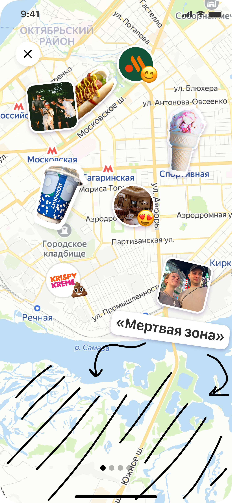

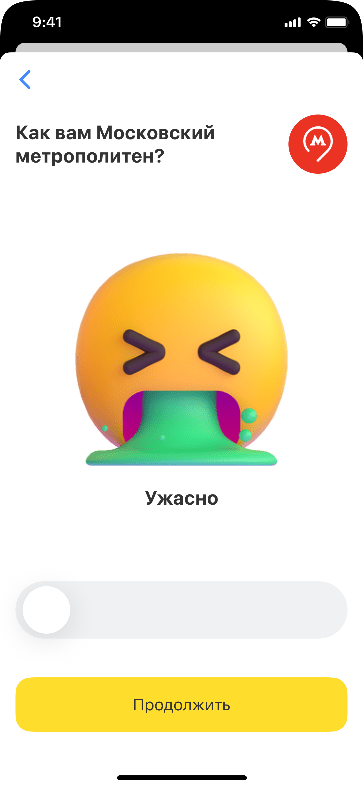

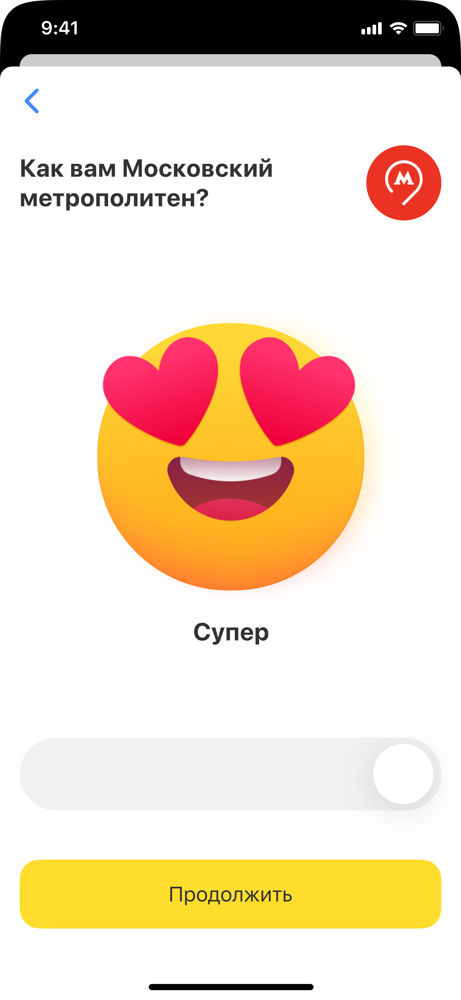

Пульс в инвестициях

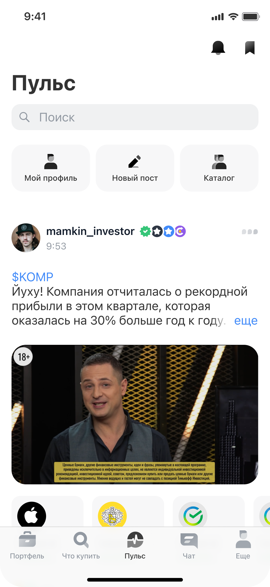

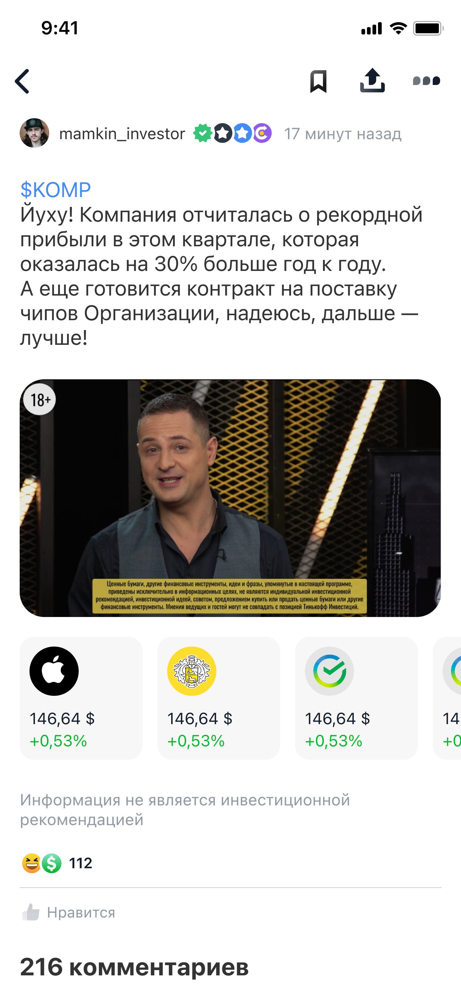

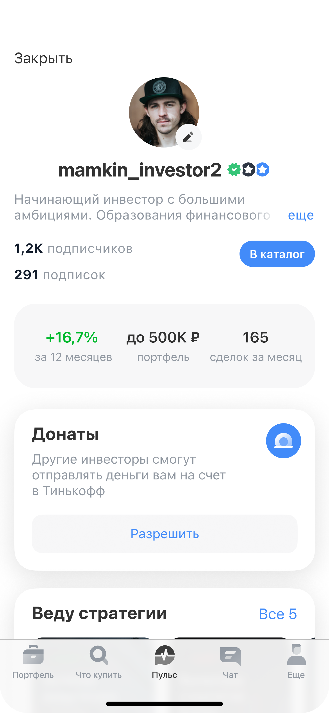

## Итоговое решение

В MVP вошла дискавери-лента с двумя табами – «Для вас» и «Подписки», фильтрами и адаптивной сеткой публикаций. Мы сохранили страницу поста для длинных материалов и предусмотрели точки входа в постинг и поиск. Редактор поста (рассказываю о нем здесь) и центр уведомлений

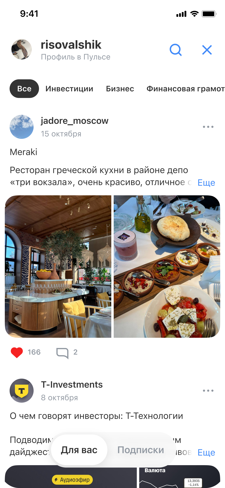

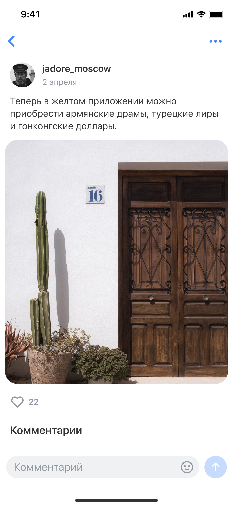

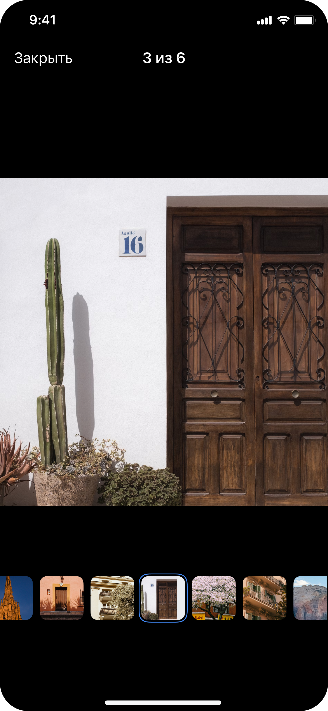

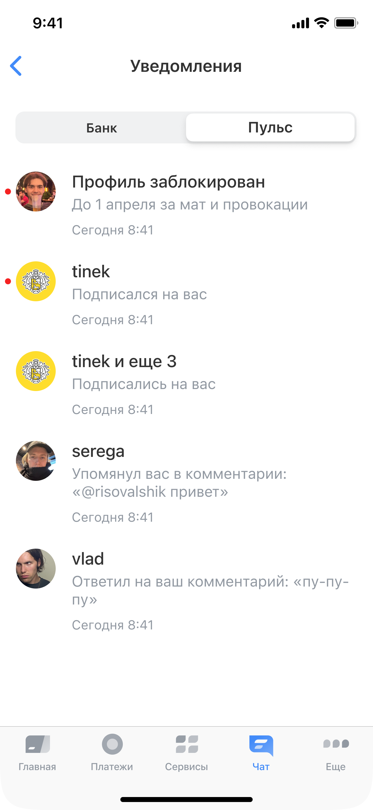

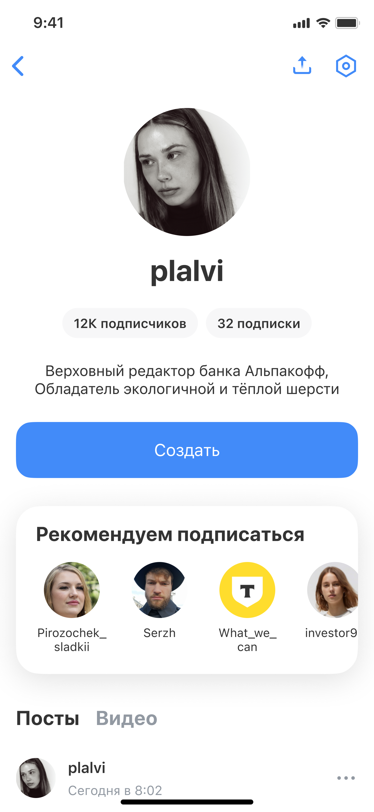

## Результат

Продукт был запущен в срок.
Через шесть месяцев после запуска:

- MAU социальной сети достиг 3 млн.

- Средний time spent вырос примерно на 100% по сравнению с предыдущей контентной лентой.

- Retention увеличился на 2%.

## Рефлексия по результатам

На этом проекте я сильно вырос как дизайнер. Возможность свободнее работать с банковской дизайн-системой дала больше пространства для поиска визуальных и продуктовых решений.
Дизайнеров в команде было мало, поэтому я много взаимодействовал с разными продактами и разработчиками. Это помогло мне расширить опыт совместной работы и лучше понимать, как продуктовые и технические ограничения влияют на дизайн.

Что можно было сделать лучше
Спустя полтора года продукт закрыли: его метрики практически не росли и оставались на стартовом уровне. В течение года мы обсуждали много концепций и вариантов вижена, но, оглядываясь назад, я вижу, что слишком много времени уходило на обсуждения и недостаточно — на проверку гипотез. На раннем этапе продукта это было особенно важно. В следующих проектах я бы раньше переходил от обсуждения концепций к их тестированию.
При этом работа получила продолжение: некоторые из обсуждавшихся концепций, например карта с рейтингами и дейтинг, сейчас запускаются как отдельные продукты. Все дизайн-решения, спроектированные мной и командой, перенесли в Пульс в Т-Инвестициях, который продолжает активно развиваться как социальная сеть для инвесторов.
