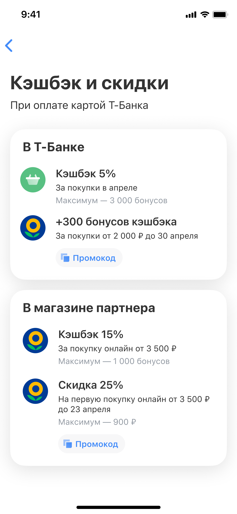
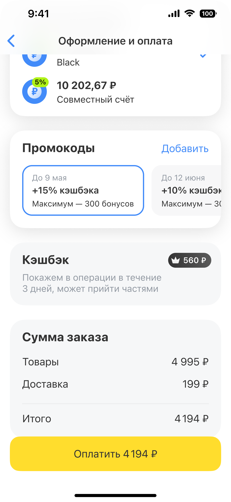

# Супермаркеты: промокоды

## Вводные

Задача — создать инструмент работы с промокодами на разных этапах пользовательского пути, который позволит запускать, тестировать и развивать промомеханики

## Команда и моя роль 

Я отвечал за дискавери и проектирование механики промокодов — от исследования существующих решений и формирования гипотез до приоритизации плейсментов и сопровождения запуска

В рамках дискавери взаимодействовал с соседними командами, чтобы учесть уже реализованные и запланированные механики

## Проблемы, которые решали

Бизнеса

В Супермаркетах не было системного инструмента для работы с промокодами: они почти не продвигались внутри продукта, а масштабируемые плейсменты для запуска и тестирования новых промомеханик отсутствовали

Пользователя

Пользователю было сложно заметить промокоды и оценить доступную выгоду

## Цели

Бизнеса

Увеличить GMV, повторные покупки и выручку за счёт промомеханик. Создать возможность проверять маркетинговые гипотезы на разных этапах воронки и развивать наиболее эффективные сценарии

Пользователя

Получать скидки и дополнительные преимущества, экономить на доставке и покупать на более выгодных условиях без лишних действий

## Итоговое решение

## Результат

По результатам запуска зафиксировали:

- Рост конверсии новичков в покупку

- Положительное влияние на GMV
Точные показатели находятся под NDA

Решение также создало основу для дальнейшего тестирования и масштабирования промомеханик внутри Супермаркетов и Маркетплейса (Шопинг)
