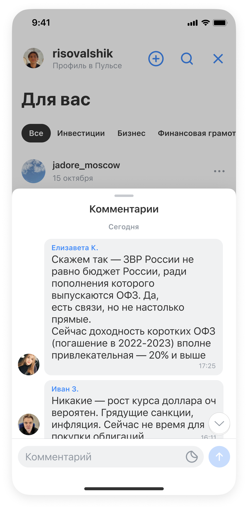
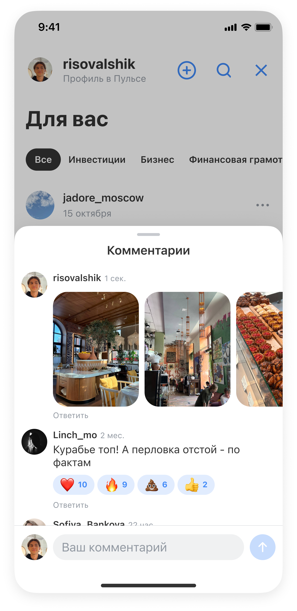
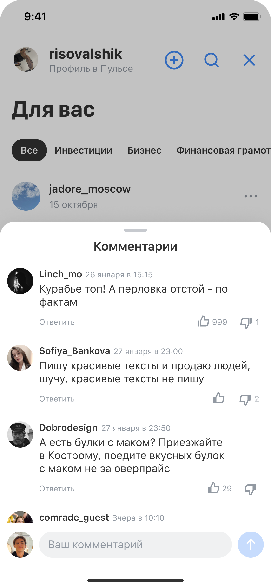
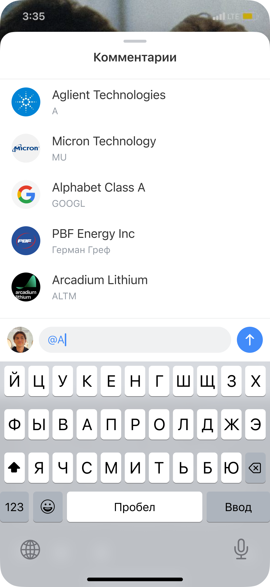

# Пульс: редизайн комментариев

## Вводные

Пульс – социальная сеть внутри экосистемы Т-Банка. Изначально продукт существовал в 
Т-Инвестициях как нишевая соцсеть для инвесторов с фокусом на аналитических текстах и профессиональном контенте. Кейс, о запуске Пульса

Комментарии – социальная механика Пульса и других контентных продуктов банка, таких как шортсы, короткие видео и истории. Задача –  сделать общение людей внутри социальной сети более вовлекающим, поддержав концепцию соцсети с сообществами и полезным контентом

## 
Команда и моя роль

Я отвечал за дизайн-вижен и развитие системы комментариев

В мою зону ответственности входили:

- Формирование продуктовой гипотезы перехода от реплаев к тредам

- Разработка целевого видения комментариев как социальной механики

- Защита дизайн-решения перед стейкхолдерами

- Декомпозиция функциональности на итерации с горизонтом развития на год

- Hi-fi дизайн и сопровождение передачи решений в разработку

## На какую аудиторию направлена задача

Все пользователи Пульса, авторы и читатели

## Проблемы, которые решали

После запуска социальной сети мы увидели по данным, что пользователи общаются 
в комментариях «деревьями» — длинными цепочками ответов. Текущая модель реплаев 
не поддерживала такое поведение и усложняла чтение и участие в дискуссиях

## Цели

Бизнеса
Увеличить количество комментариев во всех контентных продуктах. Ожидаемый эффект — усиление социального графа, рост вовлечённости и мотивации авторов создавать контент

Пользователей
Дать автору обратную связь и участвовать в обсуждении вместе с комьюнити, не теряясь в длинных цепочках ответов

## Ограничения

Комментарии использовались в нескольких продуктах. Новая система должна была стать универсальной — по сути, единым SDK для переиспользования во всех сценариях

Было

Концепт

## История решений

Анализ конкурентов и референсов
Распространённость тредов в других продуктах служила косвенным аргументом в пользу гипотезы
Смотрели на крупные и уже популярные сервисы, в частности на инстаграмм и вк, а также на редит, так как одной из наших концепций была полезная соц сеть с сообществами

Качественные и количественные исследования
Отправной точкой стали данные о длинных цепочках ответов после запуска соцсети. Также мы проводили глубинные интервью с нашими авторами, на которых они подтверждали нашу гипотезу о необходимости тредов

## Итоговое решение

Я разложил реализацию на итерации. Первую спроектировал без тредов, но с визуальной структурой, которую можно развивать под них.
От идеи с реакциями пришли к лайкам/дизлайкам. Они позволяли поддержать концепт соц сети с полезным контентом, где пользователи могут не просто ставить реакции а через лайк дизлайк оценивать полезность комментария/поста

