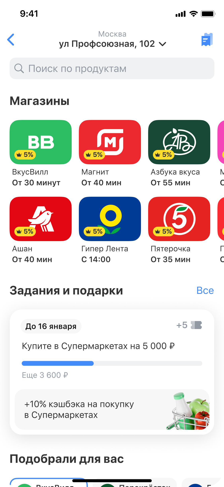
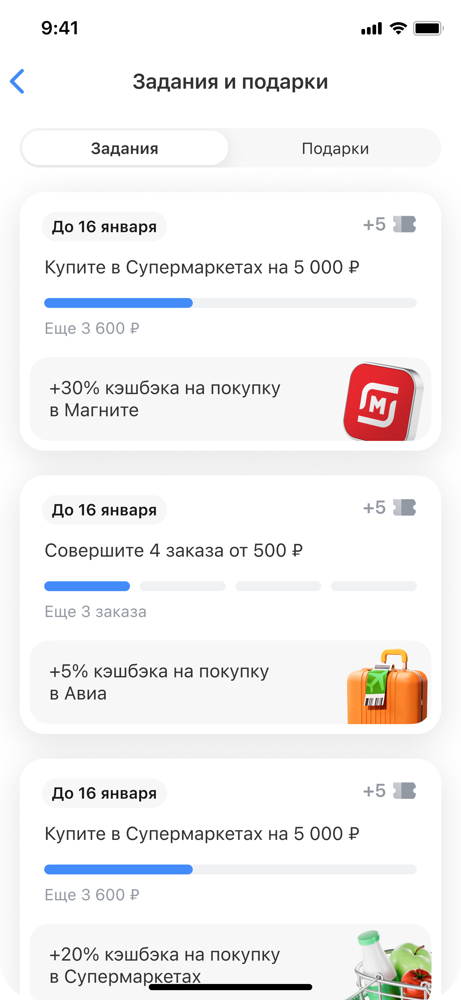
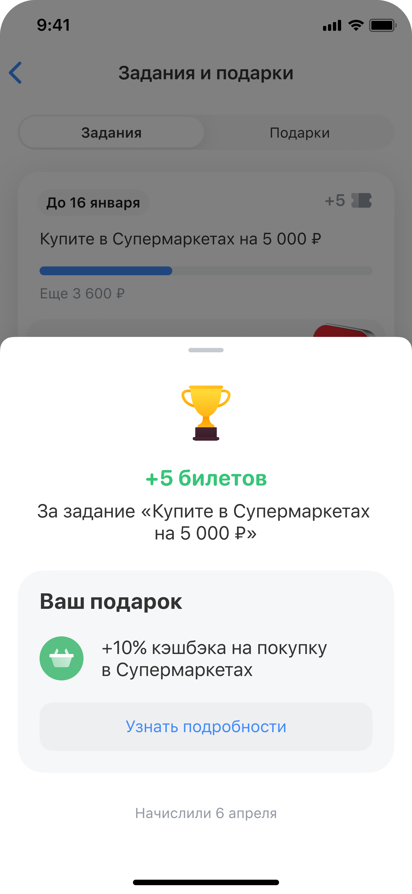

# Супермаркеты: геймификация

## Вводные

Чтобы повысить активность и удержание пользователей, мы решили внедрить в Супермаркеты механику заданий. Пользователь выполняет целевые действия внутри сервиса и получает за них гарантированную дополнительную выгоду — повышенный кэшбэк.

Основной вызов заключался в том, чтобы создать не разовую промомеханику, а долгосрочную систему, которая:

- работает с пользователями на разных этапах жизненного цикла

- влияет не только на первую, но и на последующие покупки

- масштабируется на другие сервисы Города и Выгодных покупок

- остаётся консистентной с общей экосистемой геймификации

## Моя роль

Ответственность за продуктовый подход и дизайн интеграции заданий в Супермаркеты — от определения принципов механики до проработки пользовательских сценариев и передачи решения в разработку.

Ключевые зоны ответственности:

- формирование подхода к развитию геймификации

- синхронизация с командой Призограда и другими бизнес-линиями

- проработка точек входа на разных этапах CJM

- проектирование экрана «Задания и подарки»

- поиск масштабируемого и консистентного компонентного решения

- защита решений перед стейкхолдерами

## Цель бизнеса и миссия пользователя

Цель бизнеса

Повысить удержание и активность пользователей внутри Супермаркетов:

- увеличить Retention

- обеспечить долгосрочное влияние на годовое удержание

- увеличить GMV и количество покупок

- стимулировать целевые действия: добавление товаров в корзину и оформление заказа

- снизить зависимость от Повышенного кэшбэка за счёт персонализации количества и сложности заданий

Миссия пользователя

Выполнять понятные действия и получать за них гарантированный повышенный кэшбэк, контролируя свой прогресс и заранее понимая итоговую выгоду.

## Ключевое решение

На старте рассматривалась возможность создать отдельную геймификацию внутри Супермаркетов. Я отстоял позицию, что обособленная механика приведёт к дублированию решений и сделает пользовательский опыт менее консистентным.

Вместо этого мы выбрали интеграцию с Призоградом как единым центром геймификации внутри банка. Такой подход позволял развивать механику совместно с другими бизнес-линиями и в дальнейшем масштабировать задания на разные сервисы.

Со стороны Супермаркетов я проработал:

- точки входа в задания на разных этапах пользовательского пути

- экран «Задания и подарки»

- сценарии отображения прогресса и награды

- интеграцию заданий в общую механику Призограда

## Итоговое решение

## Результат

Масштабируемое решение было синхронизировано с Призоградом и передано в разработку

По итогу получили:

- статистически значимый рост GMV (цифры под NDA)

- положительный эффект на количество покупок

- положительную динамику Retention

Решение подтвердило потенциал заданий как инструмента роста ключевых продуктовых метрик и заложило основу для дальнейшего развития геймификации в Супермаркетах и других сервисах
