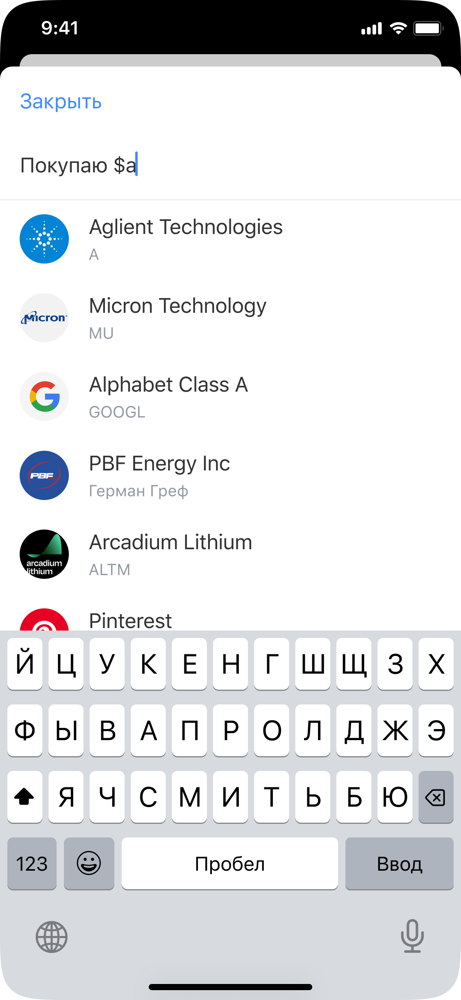
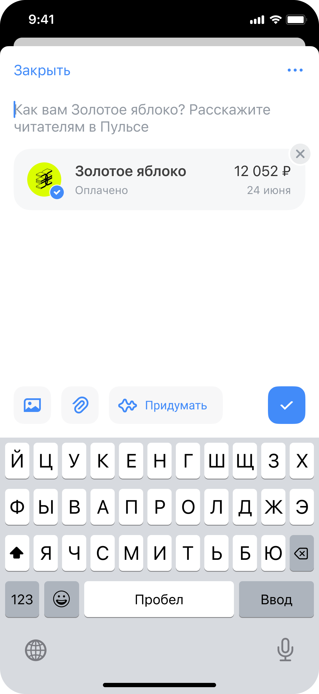
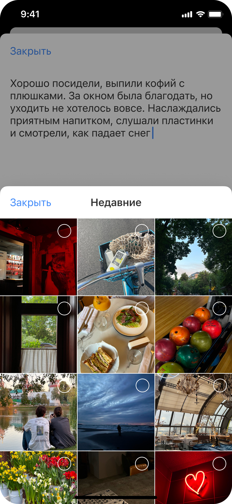

# Пульс: редактор постинга

.png)

## Вводные

Пульс – социальная сеть внутри экосистемы Т-Банка. Изначально продукт существовал в Т-Инвестициях как нишевая соцсеть для инвесторов с фокусом на аналитических текстах и профессиональном контенте. Кейс, о запуске Пульса

Редактор постов — основной инструмент создания UGC в новой социальной сети внутри банковского приложения. Задача — спроектировать его с нуля, сохранив важные сценарии инвестиционного Пульса и поддержав более широкую тематику контента

## Команда и моя роль

Я отвечал за дизайн-вижен и пользовательский опыт редактора постов.
Ключевые зоны ответственности:

- Разработка концепции редактора как основного инструмента создания UGC

- Понимание и формализация портрета автора, его мотивации и сценариев создания контента

- Проектирование UX-архитектуры и визуальной концепции с учётом продуктовых сроков

- Hi-fi дизайн и итеративная передача решений в разработку

- Контроль качества реализации, дизайн-ревью и управление дизайн-долгом

- Развитие редактора после запуска и поиск продуктового УТП

## На какую аудиторию направлена задача

Редактор должен был поддерживать две аудитории:

- Существующие авторы инвестиционного Пульса, для которых важно сохранить привычные механики публикации

- Новые авторы, в том числе создающие контент на неинвестиционные темы

## Проблемы, которые решали

Бизнеса
Старый редактор устарел по интерфейсу и архитектуре: переиспользовать его для нового продукта было невозможно

Пользователей
Старый редактор не отвечал современным потребностям создания контента в социальных сетях, фото в старом редакторе были сильно деприоритизированны, не хватало маркет нормал функционала

## Цели

Бизнеса
Обеспечить создание контента в новой социальной сети и поддержать её УТП — «верифицированный опыт», возможность делиться реальными транзакциями и действиями пользователя

Пользователей

- Создание контента с прикреплением ценных бумаг и стратегий

- Создание публикаций на неинвестиционные темы

- Удобный редактор, для создания лайфстайл контента

## Ограничения

Наследие инвестиционной соцсети. Необходимо было сохранить механики, важные для существующих авторов, включая прикрепление ценных бумаг и стратегий
Техническая архитектура. Старый редактор нельзя было переиспользовать. Новый проектировался с нуля
Сроки. Редактор должен был быстро выйти в прод, поэтому решения передавались в разработку итеративно
Продуктовое УТП. Интерфейс должен был органично поддерживать «верифицированный опыт»

## История решений

Старый инвестовый редактор  

## Итоговое решение

## Результат

После запуска:

- MAU новых авторов за первый квартал — 6 000 пользователей, ранее не создававших контент в инвестиционной соцсети.

- В среднем — 1 300 постов в неделю на неинвестиционные темы.
Параллельно был сформирован и защищён план развития редактора на год вперёд.
